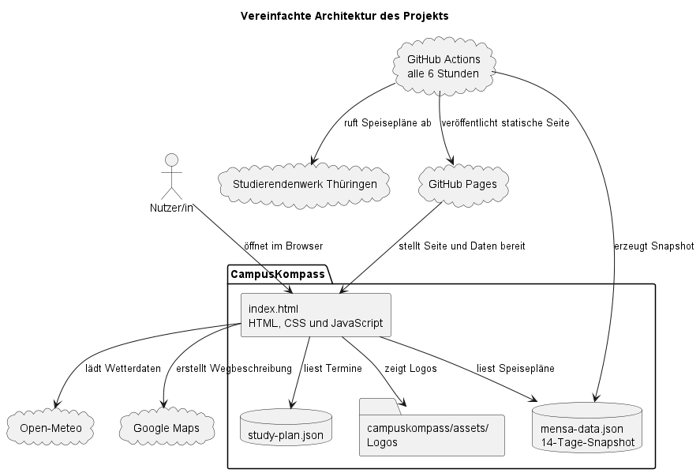

# Softwareprojekt

## CampusKompass

Vom Bedarf zur campusabhängigen Tagesplanung

**Erweiterte Projektpräsentation**

---

## Agenda

1. Ausgangslage und Projektziel
2. Anforderungen und Priorisierung
3. Bedienablauf und Campus-Kontext
4. Architektur und Datenfluss
5. Umsetzung, Qualität und Ausblick

---

## Ausgangslage

Informationen für einen Studientag sind auf verschiedene Quellen verteilt:

- Vorlesungs- und Klausurtermine
- Speisepläne der Mensen
- Wetterdaten für den jeweiligen Studienort
- Routen- und Fahrplanauskünfte

**Herausforderung:** Die Informationen müssen zum gewählten Datum und
Studienort passen.

---

## Projektziel

CampusKompass bündelt die wichtigsten Tagesinformationen in einem
browserbasierten Dashboard.

- Studienplan nach Datum filtern
- passende Mensa und campusbezogenes Wetter anzeigen
- Route und ÖPNV-Ziel für den Studienort vorbereiten
- Schmalkalden und Gera anhand des Studienplans unterscheiden

**Leitidee:** Eine Datumswahl aktualisiert alle davon abhängigen Ansichten.

---

## Anforderungen aus Nutzersicht

| ID | Nutzerziel | Use Case |
|---|---|---|
| CAMPUS-01 | Termine für einen Tag sehen | UC-02 |
| CAMPUS-02 | passenden Speiseplan sehen | UC-03 |
| CAMPUS-03 | Wetter am Campus sehen | UC-04 |
| CAMPUS-04 | Route zum Campus planen | UC-05 |
| CAMPUS-05 | passende Fahrplanauskunft öffnen | UC-06 |
| CAMPUS-06 | Datum und Uhrzeit auf „Jetzt“ setzen | UC-07 |

Die vollständigen Abläufe und Alternativen sind in den Use Cases dokumentiert.

---

## Ein typischer Ablauf

1. Die Nutzerin oder der Nutzer wählt ein Datum und eine Abfahrtszeit.
2. Das Dashboard filtert die Termine aus `study-plan.json`.
3. Der Studienort des Termins bestimmt den Campus-Kontext.
4. Mensa, Wetter, Webcam, Routenziel und Fahrplanziel werden aktualisiert.
5. Bei einem Tag ohne Termin zeigt das Dashboard einen verständlichen Hinweis.

---

## MoSCoW-Priorisierung

| Priorität | Umfang |
|---|---|
| **Must have** | Studienplan für ein Datum anzeigen |
| **Should have** | passende Mensa und campusbezogenes Wetter |
| **Could have** | Route, Fahrplanauskunft und „Jetzt“-Funktion |
| **Won't have** | Funktionen außerhalb des priorisierten MVP-Umfangs |

Die Webcam ist eine ergänzende campusabhängige Funktion der aktuellen
Umsetzung.

---

## Funktionen des Dashboards

- Termine mit Uhrzeit, Veranstaltung, Lehrkraft, Ort und Raum
- Mensaplan für Schmalkalden oder Gera
- Wetter für Campus, Datum und Uhrzeit
- Webcam passend zum Studienort
- Google-Maps-Route und VMT-Fahrplanauskunft
- Kalenderexport sowie sichtbare Lade- und Fehlerzustände

Die Oberfläche passt sich an Desktop- und mobile Bildschirmgrößen an.

---

## Der Campus-Kontext

Das ausgewählte Datum verknüpft den Studienplan mit den passenden
Standortinformationen:

| Kontext | Schmalkalden | Gera |
|---|---|---|
| Studienort | Hochschule Schmalkalden | DHGE Gera |
| Mensa | Mensa Blechhammer | Mensa Weg der Freundschaft |
| Webcam | Grasberg | Webcam Gera |
| Route und ÖPNV | Schmalkalden | Gera |

Für Tage ohne passenden Termin bleibt Schmalkalden der Standard-Campus.

---

## Vereinfachte Projektarchitektur



---

## Bereitstellung und Laufzeit

- **GitHub Pages** stellt die statische Website und Datendateien bereit.
- **GitHub Actions** aktualisiert den Mensa-Snapshot regelmäßig und
  veröffentlicht die Website.
- Das Frontend läuft im Browser und lädt lokale Projektdateien sowie externe
  Dienste.
- `server.py` dient ausschließlich der lokalen Vorschau während der
  Entwicklung.

**Wichtig:** Für den Betrieb der veröffentlichten Website ist kein eigener
Python-Backend-Server erforderlich.

---

## Mensa-Datenfluss

```text
Studierendenwerk Thüringen
          │ regelmäßiger Abruf
          ▼
    GitHub Actions
          │ erzeugt
          ▼
   mensa-data.json
          │ veröffentlicht über
          ▼
     GitHub Pages
          │ lädt im Browser
          ▼
   Mensa-Karte im Dashboard
```

Der Snapshot enthält einen begrenzten Zeitraum von heute und den folgenden
13 Kalendertagen.

---

## Frontend und Campuslogik

- `index.html` beschreibt die Dashboard-Oberfläche.
- `css/style.css` steuert Layout und responsive Darstellung.
- `js/app.js` lädt Daten, reagiert auf Eingaben und aktualisiert die Ansichten.
- `js/campus-context.js` bündelt die Zuordnung von Campus, Mensa, Wetter,
  Webcam und Routenziel.
- `study-plan.json` enthält die strukturierten Termine.

Die zentrale Campus-Zuordnung verhindert, dass jede Ansicht den Standort
unabhängig und unterschiedlich bestimmen muss.

---

## Externe Dienste

| Dienst | Verwendung |
|---|---|
| Studierendenwerk Thüringen | Quelle für die regelmäßigen Mensa-Snapshots |
| Open-Meteo | Wetterdaten für Datum, Uhrzeit und Campus |
| Google Maps | Karte und Routenplanung |
| VMT | Fahrplanauskunft für Datum, Zeit und Ziel |
| Webcam Gera / Antenne Schmalkalden | Campusabhängige Webcam-Bilder |

Die Webcam wechselt mit dem Campus; das Bild wird regelmäßig neu geladen.

---

## Daten und Grenzen

- Wettervorhersagen reichen nur begrenzt in die Zukunft; historische Daten
  hängen von der Verfügbarkeit des Wetterdienstes ab.
- Mensa-Daten sind ein Snapshot und nicht zwingend in Echtzeit.
- Externe Dienste können ausfallen, ihre Schnittstellen ändern oder Anfragen
  begrenzen.
- Die Studienplandaten müssen bei Änderungen am offiziellen Plan gepflegt
  werden.
- Webcam-Bilder hängen von der Erreichbarkeit und dem Angebot des jeweiligen
  Betreibers ab.

---

## Fehlerbehandlung und Bedienbarkeit

- Lade-, Leer- und Fehlerzustände werden direkt in den jeweiligen Karten
  angezeigt.
- Ungültige oder unvollständige Daten werden nicht als erfolgreiche Antwort
  dargestellt.
- Bei schnellen Datumswechseln werden überholte Mensa- und Wetterantworten
  verworfen.
- Dynamische Meldungen nutzen `aria-live`; Formulare und Schaltflächen sind
  beschriftet.
- Eine verweigerte Standortfreigabe kann durch manuelle Eingabe ersetzt werden.

---

## Qualitätssicherung

Das Testkonzept kombiniert technische und fachliche Prüfungen:

- Python-Syntax und JavaScript-Syntax prüfen
- JSON-Struktur von Studienplan und Mensa-Snapshot validieren
- lokalen Server starten und Dashboard im Browser öffnen
- Gera- und Schmalkalden-Termine sowie Tage ohne Termin prüfen
- Datumswechsel, externe Fehler und Standortfreigabe manuell testen

Eine vollständige End-to-End-Prüfung benötigt erreichbare externe Dienste.

---

## Rückverfolgbarkeit

```text
User Story
    ↓
Use Case
    ↓
Priorität (MoSCoW)
    ↓
Campus-Kontext und Datenquelle
    ↓
Dashboard-Funktion
    ↓
Fachlicher Testfall
```

So lässt sich nachvollziehen, wie ein Nutzerbedarf in eine Funktion und eine
Prüfung überführt wurde.

---

## Ergebnis

CampusKompass bietet eine gemeinsame Tagesansicht für zwei Studienorte.

- Der Studienplan steuert den campusabhängigen Kontext.
- Mensa und Website werden statisch veröffentlicht.
- Wetter, Webcam, Karte und Fahrplan ergänzen die Tagesplanung.
- Die Funktionen sind in Anforderungen, Use Cases und Tests dokumentiert.

---

## Ausblick

Mögliche nächste Schritte:

- automatisierte Tests für Campuswechsel und Datumslogik
- Aktualisierung der Daten bei Änderungen des offiziellen Studienplans
- bessere Kennzeichnung von Datenstand und Aktualisierungszeitpunkt
- weitere Campus-Kontexte über die zentrale Zuordnung ergänzen
- externe Abhängigkeiten und Fehlerszenarien regelmäßig nachprüfen

---

## Fragen?

**CampusKompass**  
Eine zentrale Orientierung für den Studientag.
